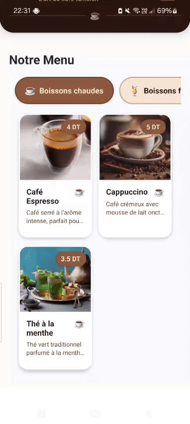

<h1 align="center">☕ Caf-App</h1>

<p align="center">
  <em>📱 Une application mobile élégante développée avec <strong>React Native / Expo</strong> pour commander dans un café.</em>
</p>

---

<p align="center">
  
  
  
</p>

---

## 📸 Aperçu

<p align="center">
  
</p>

---

## 🤎 À propos

**Caf-App** est une application mobile conçue avec passion pour offrir une expérience de commande fluide et chaleureuse. Inspirée par l'ambiance cosy des cafés artisanaux, elle combine design moderne et fonctionnalités pratiques pour les amateurs de café et de douceurs.

> *"Savourez chaque instant, de la commande à la première gorgée"* ☕✨

---

## ✨ Fonctionnalités

🍮 **Menu interactif et intuitif** — Naviguez entre les différentes catégories de boissons et pâtisseries  
🫘 **Images appétissantes** — Chaque plat est illustré pour éveiller la gourmandise  
🛍️ **Panier intelligent** — Les commandes sont sauvegardées localement  
💾 **Stockage local** — Continuez votre commande même après avoir fermé l'application  
🎨 **Design chaleureux** — Une interface aux tons café pour une expérience immersive

---

## 🚀 Installation & Lancement

```bash
# 1️⃣ Cloner le projet
git clone https://github.com/ton-utilisateur/Caf-App.git

# 2️⃣ Se déplacer dans le dossier
cd Caf-App

# 3️⃣ Installer les dépendances
npm install

# 4️⃣ Lancer l'application
npx expo start
```

---

## 🛠️ Technologies utilisées

```
☕ React Native    │ Framework mobile cross-platform
🥐 Expo           │ Plateforme de développement
🌰 AsyncStorage   │ Stockage des données locales

```

---

<p align="center">
  <strong>Fait avec 🤎 et beaucoup de café</strong>
</p>

<p align="center">
  <em>Bon appétit ! ☕🥐🍰</em>
</p>

---
